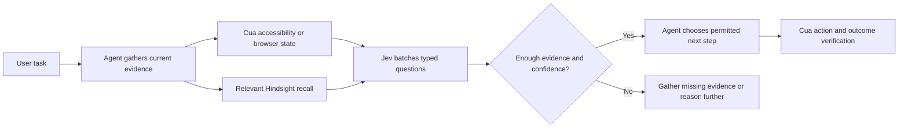

# Jev decisions and Cua Driver

The image connects agents to two separate MCP servers: Cua Driver observes and
operates the desktop; Jev answers typed questions about evidence the agent
supplies. Jev runs on TypeSafe's hosted API. No Jev weights or GPU runtime are
installed in the image.

The official integration uses `typesafe-sdk==0.7.5` and its default
`jev-latest` model. The separate PyPI package named `jev` requires Python 3.14
and discards probabilities in its high-level decorators. Using the official
SDK directly preserves the uncertainty needed for routing decisions and works
with the image's Python 3.12.

## Configuration

Set `TYPESAFE_API_KEY` in the environment settings or local Compose `.env` file.
Keep the file out of Git. The key is read at runtime and never included in the
image or MCP configuration files. Without a key, MCP discovery still works;
calls return `status: unconfigured`, `abstain: true`.

| Variable | Default | Purpose |
| --- | --- | --- |
| `TYPESAFE_API_KEY` | unset | Authenticate requests to TypeSafe |
| `TYPESAFE_DEFAULT_MODEL` | `jev-latest` | An available model name or alias |
| `JEV_TIMEOUT_SECONDS` | `8` | Total deadline for each API call; maximum 60 seconds |
| `JEV_IMAGE_ROOTS` | `/workspace:/tmp` | Colon-separated directories allowed for explicit screenshot uploads |

Outbound HTTPS to `api.typesafe.ai` is required for model calls. The SDK also
supports `TYPESAFE_BASE_URL`; leave its official default unless intentionally
using a trusted compatible service. A key by itself does not establish model
availability or endpoint access. No API request is made during image builds.

The stdio server command inside the image is:

```sh
/opt/agent-venv/bin/python /opt/agent/integrations/jev/server.py
```

Use the MCP server's `jev_decide` and `jev_assess` tools from Codex or Claude
Code. TypeSafe receives the supplied context and any explicitly selected
image. Supply only the relevant evidence. The integration does not upload
screenshots automatically or persist prompts, screenshots, or decisions.

## Use Jev to answer bounded questions

`jev_decide` selects among explicit alternatives. It asks a choice question and
a question about evidence sufficiency together, in one API request. It returns
the complete distribution and a separate confidence value. A selection is
accepted only when its probability, confidence, and evidence sufficiency all
meet the threshold, 0.85 by default. `need_more_information` is always available
as an alternative. A timeout, API failure, missing key, invalid response, or
uncertain result produces abstention.

Example tool arguments:

```json
{
  "context": "The current task is to inspect the installed Python version. A terminal is available.",
  "question": "Which interaction is sufficient?",
  "candidates": {
    "terminal": "Run python --version and read the output.",
    "desktop": "Open a browser window and inspect the desktop."
  }
}
```

`jev_assess` answers up to 32 independent yes/no questions in one request. Each
answer contains `probability_yes` and `outcome: yes | no | uncertain`. With the
default threshold, 0.85 or above means yes, 0.15 or below means no, and the
middle range stays uncertain. For example:

```json
{
  "context": "A fresh desktop observation shows a download completion notice and the expected file in the download list.",
  "questions": {
    "download_complete": "Does this observation indicate that the download completed?",
    "error_visible": "Does the observation show a download failure?"
  },
  "image_path": "/tmp/current-window.png"
}
```

Images must be PNG/JPEG files, at most 10 MiB, inside `JEV_IMAGE_ROOTS`. The
path is resolved before reading, so a symlink cannot bypass the directory
boundary. A screenshot is evidence for a decision; it does not create a Cua
capture or authorize a pixel action.

Jev does not generate a prose explanation, fetch external facts, or establish
that an action succeeded. The main agent gathers evidence, uses the typed
result if helpful, and explains its answer from that evidence. For open-ended
research or missing information, gather facts first. A high confidence score
does not establish truth or override user instructions.

## Make desktop work faster



Useful improvements already present:

- Batch questions sharing the same observation. `jev_decide` makes one call for
  both ranking and evidence sufficiency; `jev_assess` sends all named questions
  together. This avoids one model round trip per question.
- Reuse the asynchronous TypeSafe client and its connection pool for the MCP
  process lifetime. An eight-second deadline and no automatic SDK retries keep
  a failed optional decision from delaying the main agent repeatedly.
- Retain probabilities and abstention. Ambiguous decisions return to the main
  agent instead of silently choosing an action at a 0.5 cutoff.
- Start with exact shell, browser, or accessibility evidence when available.
  Send a screenshot when visual context contributes to the question.

Cua Driver 0.35.4 supplies additional useful mechanisms:

- Use fresh `element_token` values for semantic controls. Re-read a known
  window with `since: "latest"` for changes rather than repeating a large tree.
- Use `run_steps` for a known sequence, and `run_script` for bounded local
  loops or branches. Inspect the installed tool schema before using either.
- Use `get_window_state` for the exact window; its screenshot coordinates may
  be scaled. Use the returned scale and capture identity for later actions.
  Jev rankings do not replace the driver's targeting requirements.
- Keep one controller for a shared desktop. Multiple agent sessions do not
  isolate keyboard focus or application state.
- Run Cua under the same desktop user, `DISPLAY`, and
  `DBUS_SESSION_BUS_ADDRESS` as XFCE. AT-SPI needs the desktop session's D-Bus
  and `at-spi2-core`; successful MCP discovery alone does not prove capture,
  accessibility, or input delivery.

Do not reuse a decision after its UI evidence changes. No persistent response
cache is enabled. If caching is added later, key it by the exact immutable
state, questions, image digest, and model version, with a short expiry. Never
cache action authorization or reuse Cua element handles across snapshots.

## Further experiments

Measure a representative set of desktop tasks before making speed claims.
Compare the baseline agent with Jev routing using task success rate, total
wall-clock time, API latency p50/p95, main-model token usage, cost, and
abstention/error rates. Include wrong-but-confident decisions and changed UI
states. Tune thresholds on held-out tasks instead of lowering them merely to
increase the acceptance rate.

The official SDK also exposes `Box` questions for visual grounding, with an
example using `jev-preview`. This integration does not enable them: model
availability, localization accuracy, coordinate transforms, and fresh capture
identity need validation before connecting a predicted box to a click.

Hindsight can supply relevant prior outcomes to the context. Retain verified
results after completion, and evaluate whether retrieval plus typed ranking
reduces repeated exploration. The integration makes no automatic memory
writes and treats recalled content as evidence requiring current validation.

## Validation and sources

The repository tests exercise the official SDK's wire format, batched
questions, confidence gates, explicit abstention, malformed answers, deadlines,
and screenshot file boundaries without a paid API call. A stdio MCP smoke
check verifies tool discovery and graceful operation without a key. Real model
quality and latency require a configured TypeSafe account and endpoint access.

Verified source references:

- [TypeSafe introduction](https://docs.typesafe.ai/introduction)
- [Official Python SDK](https://github.com/typesafe-ai/typesafe-sdk-python)
- [Official SDK package and license](https://pypi.org/project/typesafe-sdk/0.7.5/)
- [Cua Driver source](https://github.com/trycua/cua/tree/main/libs/cua-driver)
- [Cua Driver Linux guide](https://github.com/trycua/cua/blob/main/libs/cua-driver/rust/Skills/cua-driver/LINUX.md)
- [Cua MCP protocol and bundled skills](https://github.com/trycua/cua/blob/main/libs/cua-driver/docs/mcp-protocol-and-skills.md)
- [Cua Driver package](https://pypi.org/project/cua-driver/0.35.4/)

The SDK and Cua Driver are MIT licensed. The optional `cua-perception`
extension has a separate license, including an AGPL icon detector, and is not
installed by this image.
